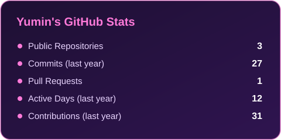
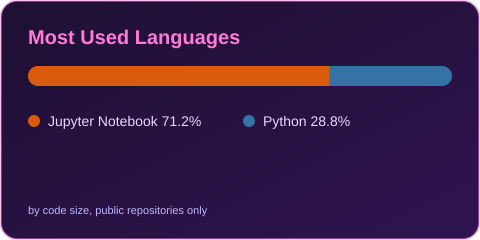
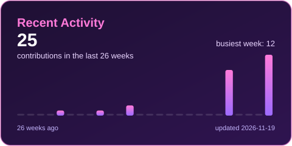
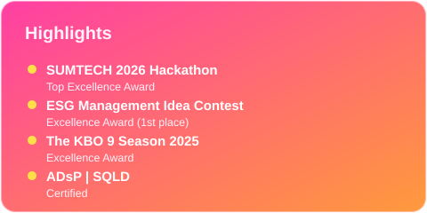

# Yumin Lee | Data Analyst Portfolio

<h3 align="center">✨ Tech Stack ✨</h3>

  &nbsp;
  &nbsp;
   
  &nbsp;
  &nbsp;
  &nbsp;
   
  &nbsp;
  &nbsp;
  &nbsp;

<h3 align="center">🛠 Tools 🛠</h3>

  &nbsp;
  &nbsp;
  &nbsp;
  &nbsp;

<h3 align="center">📊 Stats 📊</h3>

  
  
   
  
  

<h3 align="center">📮 Contact 📮</h3>

  &nbsp;
  

---

## 1. About Me

### 1.1 Background

- **[KR]** 데이터사이언스를 전공하고 스마트팩토리를 융합전공으로 이수하고 있으며, 학점은 3.99 / 4.5입니다.
- **[EN]** I major in Data Science with a convergence minor in Smart Factory, with a GPA of 3.99 / 4.5.
- **[KR]** 데이터 전처리, 통계 분석, 머신러닝 모델링, SQL 데이터베이스 설계를 수업과 프로젝트로 익혔습니다.
- **[EN]** I built skills in data preprocessing, statistical analysis, machine learning modeling, and SQL database design through coursework and projects.
- **[KR]** 모델의 정확도뿐 아니라 데이터의 신뢰성과 분석 결과가 실무에 도움이 되는지를 함께 점검합니다.
- **[EN]** Beyond model accuracy, I check whether the data is reliable and whether the results help real work.

### 1.2 Certifications and Awards

Table 1. Certifications and awards

| Item | Issuer | Date |
|---|---|---|
| SUMTECH 2026 Hackathon, Top Excellence Award | Ministry of Science and ICT, IITP, Korea Digital Contents Society (joint) | 2026.10 |
| ADsP | Korea Data Agency | 2025.11 |
| SQLD | Korea Data Agency | 2026.03 |
| The KBO 9 Season 2025, Excellence Award | Korea Baseball Organization | 2025.07 |
| ESG Management Idea Contest, Excellence Award (1st place) | University contest in cooperation with KOICA | 2026.06 |
| Online Ambassador 14th cohort, Excellence Activity Award | University Admissions Office | 2025.08 |

### 1.3 Education and Training

- **[KR]** 2025.06 ~ 2025.07에 Tableau Bootcamp 28기(10시간)와 첨단분야 혁신융합대학 CO-Week Academy(16시간, IoT 물류 자동화 스케줄링 등)를 이수했습니다.
- **[EN]** Completed Tableau Bootcamp 28th cohort (10 hours) and CO-Week Academy (16 hours, including IoT logistics automation scheduling) between 2025.06 and 2025.07.

---

## 2. Experience

### 2.1 AI Data Analysis Intern | AI Startup

- Period: 2026.06 ~

- **[KR]** 제조 공정 센서 시계열 데이터의 결측치와 이상치를 Python으로 전처리하고 구조화했습니다.
- **[EN]** Preprocessed and structured manufacturing process sensor time-series data with Python, handling missing values and outliers.
- **[KR]** 기술통계 기반으로 시계열을 벡터화하고, 회귀와 tree-based model을 비교하며 두께 예측 모델을 만들어 선형 기반 모델에서 R² 0.88을 확보했습니다.
- **[EN]** Vectorized the time series with descriptive statistics, compared regression and tree-based models to build a thickness prediction model, and reached R² 0.88 with a linear-based model.
- **[KR]** 분석 과정을 markdown으로 문서화해 재현할 수 있게 했습니다.
- **[EN]** Documented the analysis process in markdown so that it can be reproduced.

---

## 3. Projects

### 3.1 SMT Warehouse Operation Optimization | Capstone Design

- **[KR]** 팀장으로서 창고의 적치(slotting)와 작업할당(dispatching)을 하나의 의사결정 모델로 통합했습니다.
- **[EN]** As team leader, I integrated slotting and dispatching, which were previously handled separately, into one decision model.
- **[KR]** 이산 사건 시뮬레이션으로 12개 전략 조합을 비교해 무작위 배치 대비 성능을 22.4% 개선했습니다.
- **[EN]** Compared 12 strategy combinations with discrete-event simulation and improved performance by 22.4% over random placement.
- **[KR]** 팀원들과 역할을 나누고 시뮬레이션 알고리즘 설계를 주도했습니다.
- **[EN]** Divided roles with teammates and led the design of the simulation algorithm.
- **[KR]** 창고의 적재 로그를 분석해 설비별 병목을 지표로 진단했고, 의견이 갈릴 때 분석 지표를 근거로 팀을 조율했습니다.
- **[EN]** Diagnosed equipment bottlenecks from warehouse logs and used the metrics to align the team when opinions differed.
- Stack: Python, SimPy, pandas
- Repository: [warehouse-simulation-slotting-dispatching](https://github.com/Yumin-04/warehouse-simulation-slotting-dispatching)

### 3.2 Tokyo Airbnb Price Prediction

- **[KR]** 약 2.5만 건의 원천 데이터에서 결측치, 이상치, 문자열 표기를 정제했습니다.
- **[EN]** Cleaned missing values, outliers, and inconsistent strings in about 25,000 raw listings.
- **[KR]** Lasso, Ridge, SVR, boosting 등 6개 모델을 비교했고, 비선형 모델이 이 데이터의 구조를 더 잘 설명했으며 CatBoost가 R² 0.72로 가장 우수했습니다.
- **[EN]** Compared six models including Lasso, Ridge, SVR, and boosting, and found that nonlinear models explained the data better, with CatBoost the best at R² 0.72.
- **[KR]** 모델 계수와 변수 중요도로 수용 인원, 입지, 방 유형이 숙박 가격에 가장 큰 영향을 준다는 점을 도출했습니다.
- **[EN]** Identified capacity, location, and room type as the largest price drivers through model coefficients and feature importance.
- Stack: Python, pandas, scikit-learn, XGBoost, CatBoost
- Repository: [airbnb-tokyo-price-prediction](https://github.com/Yumin-04/airbnb-tokyo-price-prediction)

### 3.3 Reservation System Database Design | Siheung Youth Station

- **[KR]** 분리되어 있던 예약, 대여, 일정 관리를 통합하기 위해 요구사항을 분석하고 논리 모델과 물리 모델을 설계했습니다.
- **[EN]** Analyzed requirements and designed logical and physical models to unify reservation, rental, and schedule management that had been separate.
- **[KR]** 테이블 기술서, 도메인 정의서, 용어사전을 작성하고 SQL로 사용자별 예약과 대여, 일정 통합 조회, 페널티 사용자 확인을 구현했습니다.
- **[EN]** Wrote table, domain, and glossary documents, and implemented SQL queries for per-user reservations, integrated schedule views, and penalty checks.
- Stack: SQL, ERD

### 3.4 Commercial Area Analysis for KT Wiz | KBO Contest

- **[KR]** 수원시 행정동별 유동인구와 상권 밀집도를 공공 데이터 포털과 KOSIS 데이터로 교차 분석했습니다.
- **[EN]** Cross-analyzed floating population and commercial density by district in Suwon with open data portal and KOSIS data.
- **[KR]** 분석을 바탕으로 구단과 지역 소상공인이 함께 성장하는 상생 프로젝트를 기획해 우수상을 받았습니다.
- **[EN]** Planned a win-win project for the team and local small businesses based on the analysis, and won the Excellence Award.

### 3.5 Rural Healthcare Platform Idea | ESG Idea Contest

- **[KR]** 베트남 농촌의 낮은 의료 접근성 문제를 분석하고, 현지 약국을 거점으로 하는 원격진료와 상비약 공급 플랫폼 아이디어를 기획해 1등을 했습니다.
- **[EN]** Analyzed low healthcare access in rural Vietnam and planned a telemedicine and essential-medicine platform built on local pharmacies, winning 1st place.

### 3.6 Parent-Child Autonomy Service Planning | SUMTECH 2026 Hackathon

- **[KR]** 부모의 걱정과 성인 자녀의 자율성 사이의 갈등을 줄이는 서비스 "나도으른"을 5인 팀으로 기획했고, 기획, 프롬프트, 데이터 활용을 맡았습니다.
- **[EN]** In a team of five, planned "Nadoeureun", a service that reduces conflict between parents' concern and their adult children's autonomy, and handled planning, prompts, and data use.
- **[KR]** 자체 설문(여성 39명)으로 문제 가설을 확인했습니다. 행선지나 동행인을 다르게 말한 경험은 71.8%(28명), AI 사진 생성 기능의 사용 의향은 56.4%(22명)였으며, 응답 표본 안에서의 결과입니다.
- **[EN]** Checked the problem hypothesis with an in-team survey of 39 women: 71.8% (28) had told a different destination or companion, and 56.4% (22) were willing to use the AI photo generation feature, within the response sample.
- **[KR]** 최우수상을 받았습니다. 과학기술정보통신부, 정보통신기획평가원(IITP), 한국디지털콘텐츠학회가 공동 주최했습니다.
- **[EN]** Won the Top Excellence Award, co-hosted by the Ministry of Science and ICT, the Institute of Information and Communications Technology Planning and Evaluation (IITP), and the Korea Digital Contents Society.

---

## 4. Skills

Table 2. Technical skills

| Category | Skills |
|---|---|
| Language | Python, SQL, PL/SQL |
| Proficiency (self-assessed) | Python (advanced), SQL (intermediate), Tableau (intermediate) |
| Data Analysis | pandas, numpy, missing value and outlier handling, time-series preprocessing |
| Modeling | scikit-learn, linear regression, Lasso, Ridge, SVR, tree-based model, XGBoost, CatBoost |
| Simulation | SimPy, discrete-event simulation |
| Database | Logical and physical modeling, SQL DML |
| Visualization | Tableau, matplotlib, seaborn |
| Public Data | KOSIS, regional open data portals |
| Collaboration | Team leadership, metric-based alignment |

---

## 5. Contact

- Email: rhdwndldbals@naver.com
- GitHub: [Yumin-04](https://github.com/Yumin-04)
